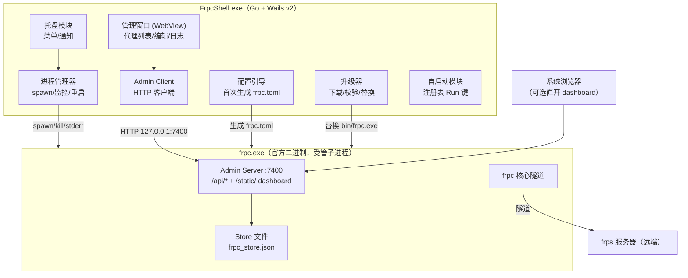
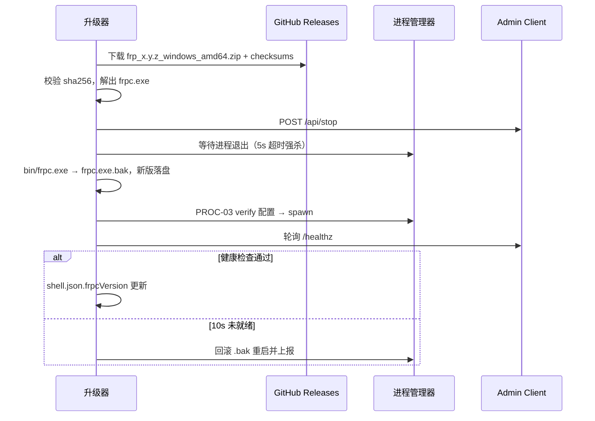

# frpc Windows 外壳（方案 A）功能与接口设计文档

| 维度 | 定位 |
|------|------|
| 文档类型 | 接口设计为主，合并概要设计（HLD）要素 |
| 系统阶段 | 全新系统（Greenfield），外壳独立于 frp 仓库开发 |
| 读者 | 外壳开发工程师、设计评审者 |
| 复杂度 | 中等（多模块，接口契约为核心内容） |
| 上游产物 | 无 PRD；本文档第一节枚举假设需求，待确认处标注 `[Hypothesis]` |

本文档中"外壳"指独立开发的 Windows 桌面程序；"frpc"指官方 release 二进制（`frp_x.y.z_windows_amd64.zip` 中的 `frpc.exe`），不修改、不重新编译。所有 frpc 侧接口契约均从 frp 源码验证（版本基线 0.6x，Go 1.26），接口清单见 [client/api_router.go](../../client/api_router.go)。

## 1 设计概述

### 1.1 目标与范围

外壳解决三个问题：让不懂命令行的用户管理 frpc；让 frpc 随系统自启、崩溃自恢复；让 frp 升级变成"替换一个文件"。

范围内：frpc 子进程生命周期管理、Admin API 代理调用、托盘与设置窗口、开机自启、frp 二进制升级、日志查看。

范围外：frps 管理功能、修改 frpc 源码、多 frpc 实例并行管理（单实例设计，`[Hypothesis]` 待确认：如果需要多实例，进程管理器按实例 ID 参数化即可，接口层已预留）。

### 1.2 假设需求（无上游 PRD，待确认）

- 用户通过图形界面完成：服务器连接配置（地址/端口/认证）、代理增删改查、查看连接状态 `[Hypothesis]`
- 高级用户仍可手改 `frpc.toml`，外壳需兼容（配置文件是唯一事实源，外壳不缓存代理配置）`[Hypothesis]`
- 界面语言中文优先，架构上预留 i18n `[Hypothesis]`

### 1.3 术语

| 术语 | 含义 |
|------|------|
| Admin API | frpc 内置 HTTP 管理接口，`webServer.port` 启用，默认 7400 |
| Store | frpc 内置持久化代理仓，通过 `store.path` 启用，`/api/store/*` 增删改查即时生效 |
| 相位（Phase） | 代理运行状态机：new / wait start / start error / running / check failed / closed |
| 受管模式 | frpc 由外壳启动并纳入监控的运行方式 |

## 2 系统架构

### 2.1 架构图



图中四个通道职责分明：外壳对 frpc 的**控制与读取**只走 `127.0.0.1:7400` 的 Admin API，一条物理通道承载全部业务接口；**进程控制**（spawn、退出码、stderr）走操作系统子进程接口；**配置落盘**由外壳首次生成、之后主要交给 frpc 自己维护（Store 模式）或经 API 写回；**数据面**流量完全不经过外壳，frpc 直连 frps，外壳宕机不影响隧道。

### 2.2 技术选型

| 选择 | 理由 |
|------|------|
| 外壳语言 Go + Wails v2 `[Expert judgment]` | 可直接 import 官方 `pkg/sdk/client` 作为 Admin API 客户端基础（省一套手写 HTTP 封装）；单 exe 交付；与 frp 同语言，后续维护者心智一致 |
| UI 复用 frpc 内置 dashboard 或基于 `web/frpc` 源码二开 `[Expert judgment]` | 该 dashboard 正是用户要求"抄"的界面（nas.cn:40710/app/frpc 即此页面），源码在本仓库 `web/frpc/`，Vue 3 + API 层齐备，一比一还原成本最低 |
| frpc 用官方 release 二进制 `[Expert judgment]` | 方案 A 核心决策：升级 = 替换文件；不 fork 源码避免跟随上游内部 API 重构（aggregator/store 即近期重构产物） |
| 自启用注册表 `HKCU\...\Run` 而非 Windows 服务 `[Expert judgment]` | frpc 以当前用户身份运行、托盘可见；服务方式无桌面交互权限且需要管理员安装 |

## 3 模块设计

| 模块 | 职责（单句） | 输入 | 输出 | 依赖 | 边界（不做） |
|------|------------|------|------|------|------------|
| 进程管理器 PM | 以受管模式拉起/停止 frpc 并监控存活 | 启动参数、退出事件 | 进程状态事件、stderr 流 | OS 子进程 API | 不解析 frpc 业务逻辑，不写配置 |
| Admin Client AC | 封装全部 Admin API 调用与错误映射 | UI/托盘的调用请求 | 强类型响应/错误 | `pkg/sdk/client` + 自扩展 Store 方法 | 不直接读 frpc 的任何文件 |
| 配置引导 CB | 首次运行生成基线 `frpc.toml`，端口冲突时改配 | 用户向导输入 | frpc.toml | 文件系统 | 不管理代理条目（归 Store API） |
| 托盘 Tray | 菜单操作入口与系统通知 | 用户点击、状态事件 | 启停命令、窗口唤起 | PM、AC | 不承载复杂交互 |
| 自启动 AS | 写/删注册表 Run 键 | 设置开关 | 注册表变更 | 注册表 API | 不做计划任务/服务 |
| 升级器 AU | 获取新版 frpc 并安全替换 | 升级检查结果 | 新二进制落盘 + 重启指令 | PM、AC、GitHub Releases | 不做版本回滚 UI（保留 .bak 手动回退） |
| 日志查看 LG | 读取并展示 frpc 日志文件 | 日志路径 | 窗口内容 | 文件系统 | 不做日志分析 |

依赖方向：Tray → PM/AC → frpc；CB、AU、LG 为被调用方。无环。

## 4 接口设计

### 4.1 接口总览

| ID | 接口 | 方向 | 用途 |
|----|------|------|------|
| API-01~18 | frpc Admin API（HTTP） | 外壳 → frpc | 状态、配置、代理/访客 CRUD、生命周期 |
| PROC-01~04 | frpc 进程接口 | 外壳 ↔ frpc | 启动、校验、版本、退出 |
| SVC-01~09 | 外壳服务接口（Wails Bindings） | 窗口 JS → 外壳 Go | 前端所需宿主能力 |

### 4.2 通用约定（Admin API）

| 项 | 约定 |
|----|------|
| Base URL | `http://127.0.0.1:{webServer.port}`（模板固定 7400） |
| 认证 | HTTP Basic，`Authorization: Basic base64(user:password)`，凭据取自 `webServer.user/password`；唯一例外 `GET /healthz` 匿名 |
| 成功响应 | 有数据返回 JSON（`Content-Type: application/json`）；`GET /api/config` 返回原始文本；无数据端点返回空体 200 |
| 错误响应 | JSON `{"Code": <int>, "Msg": "<string>"}`，HTTP 状态码与 `Code` 一致。注意字段名首字母大写（Go 结构体无 json tag），不可按 `code/msg` 小写解析 `[Data-backed]` |
| 错误码映射 | 参数/校验失败 → 400；不存在或 Store 未启用 → 404；重名冲突 → 409；其余 → 500；凭据错误 → 401 `[Data-backed]` |

### 4.3 Admin API 契约

#### API-01 `GET /healthz`

探活端点，无认证。响应：`200` 空体。外壳用它做就绪判定（见 PROC-02）。webServer 未启用时该端口不存在，探测即失败。

#### API-02 `GET /api/status`

全量代理状态。响应为按类型分组的对象：

```json
{
  "tcp": [
    {
      "name": "ssh",
      "type": "tcp",
      "status": "running",
      "err": "",
      "local_addr": "127.0.0.1:22",
      "plugin": "",
      "remote_addr": "203.0.113.7:6002",
      "source": "store"
    }
  ]
}
```

- `status` 取值见 4.4 相位表；`source` 为 `"store"` 表示 Store 管理的代理，缺省表示来自配置文件；`remote_addr` 仅在 running（或无错误）时填充，tcp/udp 类型会拼上服务器地址 `[Data-backed]`
- 外壳建议 2~3s 轮询刷新 UI `[Expert judgment]`

#### API-03 `GET /api/config`

读取当前配置文件全文。响应：`200`，原始文本（非 JSON）。

#### API-04 `PUT /api/config`

覆写配置文件（frpc 启动时 `-c` 指定的那个文件，权限 0600）。请求体：新配置全文，空体拒绝（400）。只写文件、**不自动生效**，必须随后调用 API-05 `[Data-backed]`。

#### API-05 `GET /api/reload?strictConfig={bool}`

从配置文件重新加载并校验。`strictConfig=true` 时未知字段报错。响应：`200` 空体；配置非法返回 400 且 `Msg` 含校验详情。典型序列：`PUT /api/config` → `GET /api/reload`。

#### API-06 `POST /api/stop`

优雅停止 frpc（100ms 宽限）。响应：`200` 空体，随后进程自行退出。外壳收到 200 后等待进程句柄退出，超时 5s 强杀 `[Expert judgment]`。

#### API-07 `GET /api/proxy/{name}/config`

按名称查代理配置（运行中优先，Store 兜底）。`{name}` 需 URL 编码。响应：ProxyDefinition 结构（同 API-10）。404 表示不存在。

#### API-08 `GET /api/visitor/{name}/config`

同上，面向访客（Visitor），响应为 VisitorDefinition（同 API-15）。

#### API-09 `GET /api/store/proxies`

列出 Store 全部代理。响应：`{"proxies": [ProxyDefinition, ...]}`，按 name 排序。

#### API-10 `POST /api/store/proxies`

创建代理并**立即生效、持久化**（内部完成：校验 → 写 Store 文件 → 自动重载，无需再调 reload `[Data-backed]`）。请求体为 ProxyDefinition：

```json
{
  "name": "ssh",
  "type": "tcp",
  "tcp": {
    "localIP": "127.0.0.1",
    "localPort": 22,
    "remotePort": 6002
  }
}
```

ProxyDefinition 校验规则：`name` 非空；`type` ∈ `tcp|udp|http|https|tcpmux|stcp|sudp|xtcp`；**恰好提供一个与 type 同名的类型块**（如 `type=tcp` 只能有 `"tcp": {...}`，多给或没有都报 400）`[Data-backed]`。响应：`200`，创建后的完整定义。重名 → 409。

类型块关键字段（JSON 键为 camelCase，与 `frpc_full_example.toml` 一致，完整字段以该文件为准）：

| 类型块 | 核心字段 |
|--------|---------|
| tcp / udp | `localIP` `localPort` `remotePort` |
| http / https | `localIP` `localPort` `customDomains[]` `subdomain` |
| tcpmux | `customDomains[]` `multiplexer` `routeByHTTPUser` |
| stcp / sudp | `secretKey` `allowUsers[]` |
| xtcp | `secretKey` |

#### API-11 `GET /api/store/proxies/{name}` / API-12 `PUT .../{name}` / API-13 `DELETE .../{name}`

单代理查/改/删。PUT 请求体 URL 中 name 必须与 body.name 一致（否则 400），删除即时生效并持久化。响应：GET/PUT 返回 ProxyDefinition，DELETE 空体 200。

#### API-14~18 `/api/store/visitors` 系列

与 API-09~13 完全同构，对象为访客。`type` ∈ `stcp|sudp|xtcp`，类型块恰好一个。创建示例：

```json
{
  "name": "office-ssh",
  "type": "stcp",
  "stcp": {
    "serverName": "ssh",
    "secretKey": "your-secret",
    "bindAddr": "127.0.0.1",
    "bindPort": 6003
  }
}
```

#### Store API 可用性

`store.path` 未配置时上述 API-09~18 **路由不注册**，请求得 404。外壳启动时探测（GET /api/store/proxies），404 则进入降级模式：仅提供配置文件编辑（API-03~05），代理管理 UI 置灰 `[Expert judgment]`。

### 4.4 代理相位（status 字段取值）

| 相位 | 含义 | UI 建议呈现 |
|------|------|------------|
| `new` | 刚创建未启动 | 灰色 |
| `wait start` | 等待服务端确认 | 黄色 |
| `start error` | 启动失败（端口占用等） | 红色 + `err` 字段 |
| `running` | 正常 | 绿色 + remote_addr 可点击复制 |
| `check failed` | 本地健康检查失败 | 橙色 |
| `closed` | 已关闭 | 灰色 |

`[Data-backed]` 相位机源码 [proxy_wrapper.go](../../client/proxy/proxy_wrapper.go)。

### 4.5 进程接口（PROC）

| ID | 接口 | 契约 |
|----|------|------|
| PROC-01 启动 | `frpc.exe -c <安装目录>\frpc.toml`，工作目录设为安装目录 | 成功后常驻；**首次登录失败即退出**（`loginFailExit` 默认 true），外壳生成的模板必须写 `loginFailExit = false` 使断网时保持重试 `[Data-backed]` |
| PROC-02 就绪判定 | 轮询 `GET /healthz` | 启动后每 300ms 探测，累计 10s 未通视为启动失败，收集 stderr 与退出码上报 `[Expert judgment]` |
| PROC-03 配置校验 | `frpc.exe verify -c <file>` | 输出 `frpc: the configuration file <path> syntax is ok`；失败打印错误并退出码 1。升级前/配置保存前调用 `[Data-backed]` |
| PROC-04 版本查询 | `frpc.exe -v` | 单行版本串（如 `0.61.1`）。用于升级比对与"关于"页 |
| PROC-05 停止 | 优先 `POST /api/stop`；进程句柄 5s 未退出则 `TerminateProcess` | 退出码不以 0 结束视为异常，触发崩溃处理路径 |

启动失败常见退出码语义：配置解析失败、端口占用（webServer/metrics 绑定失败）均以 exit 1 + stderr 输出呈现，外壳需把 stderr 尾部 20 行透出到通知 `[Expert judgment]`。

### 4.6 外壳服务接口（Wails Bindings，SVC）

窗口前端（Vue 3，复用 `web/frpc` 页面结构）通过 Wails 绑定调用宿主能力。方法签名（Go 侧导出方法）：

| ID | 方法 | 说明 |
|----|------|------|
| SVC-01 | `FrpcStatus() (StatusSnapshot, error)` | 聚合：进程存活 + API-02 状态 + Store 可用性 |
| SVC-02 | `FrpcControl(action string) error` | `start` / `stop` / `restart` |
| SVC-03 | `CallAdmin(method, path, body string) (int, string, error)` | 通用代理通道：前端直调任意 Admin API（避免为 18 个端点逐一暴露绑定）；返回 HTTP 状态码与响应体 `[Expert judgment]` |
| SVC-04 | `GetSettings() / SaveSettings(Settings)` | 外壳自身设置（自启、开机启动 frpc、语言、admin 凭据） |
| SVC-05 | `OpenLogWindow()` / `ReadLogTail(lines int)` | 日志 |
| SVC-06 | `CheckUpgrade() (UpgradeInfo, error)` | 查 GitHub Releases 最新 `frp_windows_amd64.zip` 与本地版本比对 |
| SVC-07 | `ApplyUpgrade() error` | 执行 5 节升级序列 |
| SVC-08 | `OpenDashboardInBrowser()` | 调系统浏览器打开 `http://127.0.0.1:7400/static/`（内置 dashboard 全功能可用） |
| SVC-09 | `FrpcVersion() string` | PROC-04 包装，缓存结果 |

`SVC-03` 是接口设计的枢纽：`web/frpc` 前端已有完整的 API 层（[frpc.ts](../../web/frpc/src/api/frpc.ts)），前端代码近乎原样复用，仅把 `fetch` 换成 Wails 调用，即可零成本获得与 nas.cn 上 dashboard 一致的界面与交互。

## 5 数据设计

### 5.1 安装目录布局

```
FrpcShell/
├── FrpcShell.exe          外壳
├── bin/
│   ├── frpc.exe           受管官方二进制（升级时替换）
│   └── frpc.exe.bak       上一版本备份
├── frpc.toml              受管配置（唯一事实源）
├── store/
│   └── frpc_store.json    Store 持久化文件（frpc 写，外壳只读展示）
├── logs/
│   └── frpc.log           frpc 日志（log.to 指定）
└── data/
    └── shell.json         外壳自身状态
```

### 5.2 外壳生成的基线 frpc.toml

```toml
serverAddr = "x.x.x.x"        # 向导填写
serverPort = 7000
auth.token = "xxxxxxxx"       # 向导填写
loginFailExit = false          # 必设：首次登录失败不退出，保持重试

log.to = "./logs/frpc.log"
log.level = "info"
log.maxDays = 7

webServer.addr = "127.0.0.1"
webServer.port = 7400
webServer.user = "admin"
webServer.password = "<随机生成>"

store.path = "./store/frpc_store.json"   # 启用 Store，相对路径相对配置文件目录解析
```

`store.path` 相对路径按配置文件所在目录解析 `[Data-backed]`；`loginFailExit=false` 与 `store.path` 是外壳可用的两个前提，缺一则降级路径见第 6 节。

### 5.3 shell.json（外壳状态）

| 字段 | 类型 | 说明 |
|------|------|------|
| frpcVersion | string | 当前 bin/frpc.exe 版本，来自 PROC-04 |
| adminPort | int | 当前 admin 端口（冲突自动改配后更新） |
| autostart | bool | 自启开关镜像 |
| onboarded | bool | 首次向导是否完成 |
| lastUpgradeCheck | datetime | 上次升级检查时间 |

代理配置不进 shell.json——配置事实源只有 frpc.toml 与 store 文件，外壳重启后从 API 读回，天然与手改配置兼容。

## 6 错误处理与故障矩阵

| 故障 | 检测 | 处置 | 用户可见 |
|------|------|------|---------|
| 启动即退出（配置错/端口占用） | PROC-02 超时 + 退出码 1 | 停止重试；读 stderr 尾部 | 通知栏 + 日志窗口高亮错误行 |
| frpc 运行中崩溃 | 进程句柄退出事件 | 指数退避重启（1s 起步，上限 60s，连续 5 次失败停止并告警） `[Expert judgment]` | 托盘图标变红 + 通知 |
| Admin API 无响应（frpc 假死） | SVC-01 请求超时 3s | 连续 3 次超时按崩溃处理 | 状态页显示"无响应" |
| 7400 被占用 | 启动失败 stderr 含 bind 报错 | 自动改配 webServer.port = 7401 递增重试，更新 shell.json | 一次性提示 |
| Store API 404 | 启动探测 | 降级：只保留配置编辑功能 | 代理管理页置灰并说明 |
| Admin API 401 | 任意调用 | 提示"凭据与配置不一致"（配置被手改），提供一键修复 | 弹窗 |
| 升级下载失败/校验不过 | AU 校验 sha256 | 保留旧版，标记升级失败 | 设置页错误信息 |

## 7 版本升级与迭代

### 7.1 frp 升级序列（SVC-07 执行）



序列的每一步都有回退点：下载失败不动线上文件；替换后起不来则自动回滚 `.bak`。旧配置与新版本的兼容性由 PROC-03（新二进制 verify 旧配置）在重启前把关，不通过则中止升级并提示。

### 7.2 兼容性策略

- 外壳唯一依赖 frpc 的对外契约：Admin API（frpc 自家 dashboard 同样依赖，上游破坏该接口等于破坏自身功能，稳定性有保证 `[Expert judgment]`）+ 进程 CLI 参数。两者均属 frp 文档化行为
- 每次外壳发版在 CI 用"当前 frp 最新 release + 上一个 release"双版本跑冒烟（spawn → healthz → status → store CRUD）`[Expert judgment]`
- frp 升级与外壳升级完全解耦：外壳不重发版即可换 frp；frp 出破坏性变更时才需要外壳跟进发版

### 7.3 迭代路线建议

1. **M1 可用**：向导生成配置、受管启动、托盘启停、复用 dashboard 浏览器入口（SVC-08）——纯托盘程序即可交付
2. **M2 好用**：内嵌窗口复用 `web/frpc` 界面（SVC-03 通道）、状态轮询、日志窗口、开机自启
3. **M3 省心**：在线升级、崩溃自恢复策略完善、多语言
